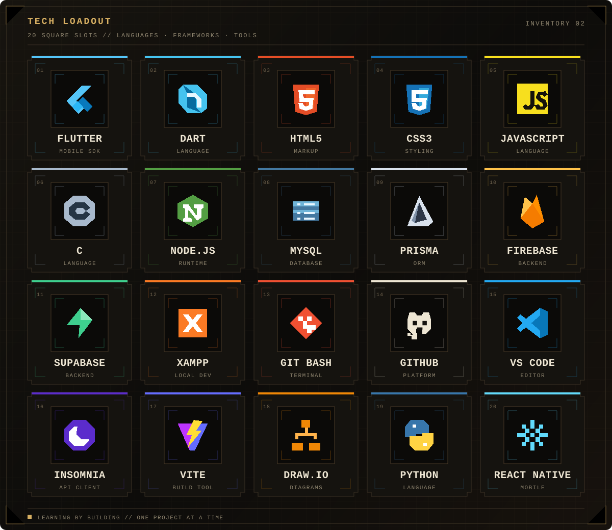

<p align="center">
  
</p>

<p align="center">
  <a href="https://portfolio-enzotoniato.vercel.app/"><strong>PORTFOLIO ↗</strong></a>
  &nbsp;/&nbsp;
  <a href="#03--selected-quests">PROJECTS</a>
  &nbsp;/&nbsp;
  <a href="https://github.com/zenvexy?tab=repositories">REPOSITORIES</a>
  &nbsp;/&nbsp;
  <a href="https://github.com/zenvexy?tab=overview">ACTIVITY</a>
</p>

<h3 align="center">Learning the systems. Building the experience.</h3>

<p align="center">
  I'm <strong>Enzo Toniato</strong>, a Systems Development student exploring<br />
  the space between <strong>mobile apps</strong>, <strong>web interfaces</strong> and <strong>the APIs behind them</strong>.
</p>

<p align="center"></p>

## 01 / Character sheet

I learn by making things: a personal portfolio, a collaborative pixel-art fighting game, a recipe app connected to its own API. Each project is another chance to understand how the pieces fit together — from the first screen to the database.

```text
class       →  Full-stack developer in training
main quest  →  Turn real problems into useful, intuitive software
playstyle   →  Build something. Understand it. Make it better.
passive     →  Keep showing up.
```

<details>
<summary><strong>Ler em português 🇧🇷</strong></summary>

Sou o **Enzo Toniato**, estudante de **Desenvolvimento de Sistemas**. Estou construindo minha base em desenvolvimento mobile, frontend, backend e bancos de dados.

Gosto de aprender colocando a mão no código: criar uma interface, conectar uma API, entender um erro e voltar com uma solução melhor. Meu foco é desenvolver projetos úteis, com organização, clareza e uma experiência que faça sentido para quem usa.

**A missão:** transformar estudo em prática e prática em evolução, um commit de cada vez.

</details>

<p align="center"></p>

## 02 / Skill tree

The tools I've learned and put to work, presented as a pixel-art loadout.

<p align="center">
  
</p>

<details>
<summary><strong>Open the inventory — tools &amp; fundamentals</strong></summary>

| Slot | Equipment |
| :--- | :--- |
| Languages | JavaScript · Dart · C · Python |
| Mobile | Flutter · React Native |
| Frontend | HTML5 · CSS3 · Vite |
| Backend & data | Node.js · Prisma · MySQL · Firebase · Supabase |
| Workbench | Git · GitHub · Git Bash · VS Code · Insomnia · XAMPP · Draw.io |

</details>

<p align="center"></p>

## 03 / Selected quests

### I. The portfolio

**A home for the things I build.** A responsive portfolio with theme selection, Portuguese/English translation and a project archive.

`HTML` `CSS` `JavaScript` `i18next`

[Explore the portfolio ↗](https://portfolio-enzotoniato.vercel.app/) · [Read the code](https://github.com/zenvexy/Portifolio-EnzoToniato567)

<p align="center"></p>

### II. Galactic Duel

**A different kind of merge conflict.** A collaborative Star Wars fan game with 1v1 pixel-art battles, animated fighters and multiple arenas. Built with a team.

`React` `TypeScript` `Vite` `Tailwind CSS`

[Enter the arena ↗](https://starwars-galactic-duel.vercel.app/) · [Read the code & meet the team](https://github.com/zenvexy/StarWars-Galactic-Duel)

<p align="center"></p>

### III. Livro de Receitas

**From the screen to the API.** A Flutter recipe app with search, recipe management and light/dark themes, connected to its own backend.

`Flutter` `Dart` `REST API`

[Explore the app ↗](https://github.com/zenvexy/Flutter-API-Receitas) · [Follow the backend](https://github.com/zenvexy/Backend-Receitas-Flutter)

[**See the whole quest log →**](https://github.com/zenvexy?tab=repositories)

<p align="center"></p>

## 04 / Next checkpoints

- [ ] Go deeper into Node.js and scalable API development.
- [ ] Give projects documentation that makes them easier to understand and run.
- [ ] Strengthen testing habits and code quality.
- [ ] Learn more about architecture and design patterns.
- [ ] Build and contribute consistently with other developers.

<p align="center">
  
</p>

<p align="center"><em>Take a breath. Save your progress. There's more to build.</em></p>

<p align="center">
  
</p>

<p align="center">
  <a href="https://github.com/zenvexy"><strong>@zenvexy</strong></a>
  · Enzo Toniato
  · <em>Still learning. Still building.</em>
</p>
